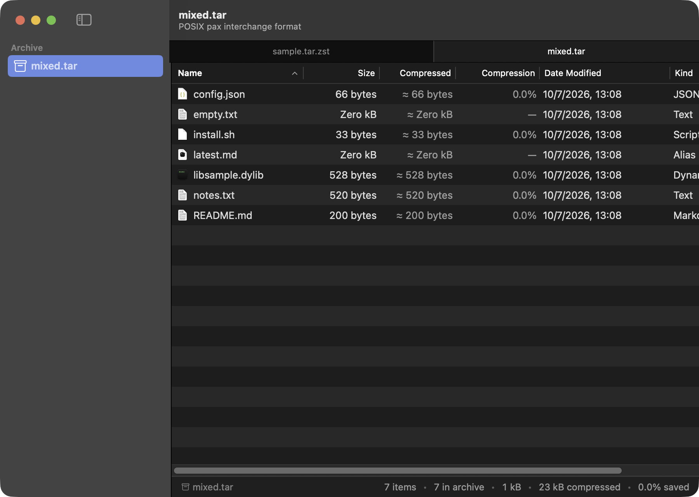

# ArchiveCat 🐱📦

A native macOS archive browser — and a small, careful archive creator.

ArchiveCat opens an archive and lets you look inside it **like a folder** —
without extracting it. Archives inside archives open the same way. Think
Finder × BetterZip × Quick Look, built with AppKit and SwiftUI, backed by
libarchive.

It never modifies an archive. It can also create a **new** archive from files
and folders on disk, which is a separate operation: the reader is read-only,
permanently.



---

## What it does

* **Opens an archive and scans it in the background.** Format detection is
  libarchive's job, not the file extension's: ZIP, TAR, TAR.GZ/BZ2/XZ/ZST, 7z,
  RAR (as far as the linked libarchive supports it), CPIO, XAR, ISO and more.
* **Builds a virtual directory tree.** Archives store flat paths; ArchiveCat
  turns them into a hierarchy, synthesizing the folders an archive forgot to
  record (the usual case for `tar cf x.tar usr/bin/tool`).
* **Browses like Finder.** A native source list for the tree, a real
  `NSTableView` for the file list with sortable columns, breadcrumb navigation,
  back/forward history, and an inspector pane.
* **Opens archives inside archives.** Double-click `artifacts/backup.tar.gz`
  inside `project.zip` and browse it in place. The parent archive is never
  extracted or modified; only that one member is materialised, into a bounded
  cache. The breadcrumb shows the chain, and ⌘↑ or ⌘← steps back out.
* **Previews with Space.** Only the selected entry is extracted, into a
  keyed cache under `~/Library/Caches/com.frankruan.ArchiveCat/Preview/`, and
  handed to the system Quick Look panel. This works inside nested archives too.
* **Drags files into the Finder.** Drag one or many entries out and the Finder
  receives real files. Nothing is extracted at drag time — the payload is
  produced on drop, via `NSFilePromiseProvider`.
* **Extracts selectively.** One file, a selection, a folder subtree, or the
  whole archive — with a destination picker, a real question when files already
  exist (Replace / Skip / Keep Both / Cancel), live progress and cancellation.
* **Creates archives.** Choose files and folders, pick ZIP or TAR + gzip (or
  TAR/BZ2/XZ/ZST), choose a name and level, watch progress, cancel if you like.
  The archive is written to a temporary file and moved into place atomically, so
  a failure or a cancel never leaves a partial archive behind.
* **Searches names and paths** against the in-memory index, as you type.
* **Inspects metadata.** Sizes, compression ratio, POSIX permissions, UID/GID,
  link counts, symlink targets, device numbers, and an on-demand content check
  that identifies Mach-O binaries (including their architectures), ELF objects,
  static libraries, plists, JSON, scripts and text.
* **Knows what it can do.** One capability model answers "can I read this?",
  "can I reach one member efficiently?", "can I create this format?", and the UI
  enables actions from it, so a format is never offered on an assumption.

## What it never does

* It never modifies an existing archive: no renaming, deleting, adding, or
  saving. The reader has no write path at all, and creation always produces a
  **new** file.
* It never extracts the whole archive as a side effect of browsing, previewing,
  searching, dragging or opening a nested archive.
* It never overwrites a file silently — extraction asks, and archive creation
  relies on the save panel's explicit replace question.
* It never follows a symlink out of an archive or out of a selected folder.
* It never lets an archive write outside the folder you chose.

---

## Requirements

* macOS 14 or later (Apple Silicon first; the code is architecture-neutral)
* Xcode 16 or later (this checkout was built with Xcode 27 / Swift 6.4)
* [libarchive](https://libarchive.org) from Homebrew:

```sh
brew install libarchive
```

ArchiveCat uses the libarchive **dylib** rather than a vendored copy, so the
headers and the library always agree. `Package.swift` finds it automatically in
`/opt/homebrew/opt/libarchive` (Apple Silicon) or `/usr/local/opt/libarchive`
(Intel); set `LIBARCHIVE_PREFIX` to point somewhere else.

## Build and run

```sh
make test     # engine + browser-model suites
make build    # build everything, debug
make app      # assemble dist/ArchiveCat.app (release, signed, self-contained)
make run      # build and launch it
```

`make app` bundles libarchive and its Homebrew dependencies into
`ArchiveCat.app/Contents/Frameworks` and rewrites their install names, so the
resulting app does not depend on Homebrew being installed on the machine that
runs it. It is signed ad-hoc with the sandbox entitlements from
`Resources/ArchiveCat.entitlements`; set `CODESIGN_IDENTITY` to sign with a real
identity.

All SwiftPM invocations go through `Scripts/swift.sh`, which pins every cache
(SwiftPM, Clang modules, `TMPDIR`) inside `.build/`. That keeps builds working
in sandboxes and CI, and keeps them from scattering files across your home
directory.

### Opening an archive in the built app

`open -a dist/ArchiveCat.app some.tar.zst`, or drag an archive onto the window,
or use File ▸ Open (⌘O). The app registers as an *alternate* handler for archive
types: macOS ships Archive Utility as the default, and hijacking that would be
rude. Set ArchiveCat as the default for a type in Finder's Get Info if you want
it to own double-clicks.

---

## Browsing archives inside archives

An archive member that *is* an archive opens as another level in the same
window: the document still owns the window, and the browser keeps a stack of
archive levels.

* Return or double-click opens the selected archive member in place.
* Go ▸ Open Archive Inside (⇧⌘O) and the context menu item do the same.
* ⌘↑ (Enclosing Folder) and ⌘← (Back) step out of a nested archive at its root
  and return to the folder the parent was left in.
* The breadcrumb is a location with two parts: the archive chain
  (`project.zip › backup.tar.gz`) and the folder inside the innermost one.
  Clicking an archive segment pops back to it.
* Quick Look, extraction, drag-out and Copy Path act on the archive you are
  looking at, not the document's root archive.

Resource rules for nested archives:

| Limit | Default |
| --- | --- |
| nesting depth | 4 |
| single materialised member | 2 GiB |
| total nested-cache budget | 4 GiB |
| cache entry age | 24 hours |

An open level pins its materialised file, so navigating away and back — or
having Quick Look open — cannot have the file evicted underneath it. Eviction
is LRU over unreferenced entries only, and scan results are cached so revisiting
a large nested archive does not rescan it.

## Creating archives

File ▸ Create Archive… (⇧⌘N), or the Create Archive… button in the empty state.

1. Choose one or more files and folders.
2. Choose a name, location and format in the standard save panel, which carries
   format and compression-level controls.
3. Watch progress; cancel at any point.

Output formats are the ones this build's libarchive can actually write:

| Format | Extension | Levels |
| --- | --- | --- |
| ZIP | `.zip` | 0–9 (0 = store) |
| TAR | `.tar` | — |
| TAR + gzip | `.tar.gz` | 0–9 |
| TAR + bzip2 | `.tar.bz2` | 1–9 |
| TAR + xz | `.tar.xz` | 0–9 |
| TAR + zstd | `.tar.zst` | 1–19 |

The list is probed at runtime (`LibArchiveWriter.probe`): if the linked
libarchive was built without a filter, that format simply is not offered.

What creation does and does not do:

* A selected folder becomes a top-level folder in the archive, like Finder's
  Compress. Relative structure, empty folders and unicode names are preserved.
* Overlapping selections collapse; two selected items with the same name are
  disambiguated (`src`, `src 2`) and reported.
* Absolute paths and your home directory never appear inside the archive.
* **Symlinks are stored as symlinks and never followed**, so a link to `/etc`
  cannot leak its target and a link loop cannot recurse. FIFOs, sockets and
  device nodes are skipped and reported.
* Everything is planned and validated before writing starts; a missing,
  unreadable or shrinking source aborts the run instead of producing an archive
  with a corrupt member.
* The archive is written to `.<name>.<uuid>.partial` next to the destination,
  fsynced, then committed with `rename(2)` — or with
  `renameatx_np(RENAME_EXCL)` when the destination must not be clobbered, so
  even a race cannot overwrite a file. A failed or cancelled run removes the
  temporary file and leaves the destination untouched.
* Durability: the file is fsynced before the rename; the directory entry is not
  fsynced, so a machine crash immediately after the rename could lose the name.
  An existing file cannot be destroyed by a failed replace.

Dropping files onto the welcome window is not wired to creation: dropping an
*archive* opens it, which is the one meaning a drop has always had here.

---

## Architecture

```
Sources/
├── CArchive/               C shim over libarchive; the only place the C headers appear
├── ArchiveCore/            The engine, with no UI dependency at all
│   ├── Capabilities/       ArchiveCapabilities: what a session/format can do
│   ├── Reading/            ArchiveSession, the read bridge, path safety, scanner
│   ├── VirtualFileSystem/  ArchiveFileSystem, ArchiveNode, bounded content reads
│   ├── Nested/             NestedArchiveStore: materialise, limit, pin, evict
│   ├── Tree/               Virtual directory tree and archive-level summary
│   ├── Extraction/         Selective extraction and the openat-based secure writer
│   ├── Preview/            Single-entry materialisation and the preview cache
│   ├── Writing/            Format catalogue, write bridge, planner, compression service
│   ├── Inspection/         Mach-O / ELF / plist / JSON / text identification
│   ├── Search/             Name and path search over the metadata index
│   └── Utilities/          Errors, logging categories, formatting, POSIX types
└── ArchiveCat/             The application
    ├── App/                NSDocument, window controller, toolbar, menu bar
    ├── Models/             BrowserViewModel (archive levels), EntryRow, sort spec
    ├── UI/                 SwiftUI views + the AppKit entry table
    ├── Preview/            Quick Look panel integration
    └── Utilities/          Icons, drag promises, extraction/compression coordination
```

`Docs/ARCHITECTURE.md` records the layering, the invariants and the two
responsibilities (reader and creator) in more detail.

Three rules hold the design together:

1. **`CArchive` is the only door to C.** The libarchive imports are confined to
   the reading bridge, the scanner, the extraction service and the writer; no
   libarchive pointer ever outlives the call that produced it.
2. **The engine knows nothing about the UI.** `ArchiveCore` is exercised
   headlessly by the test suite — no window is created.
3. **The UI owns no archive state.** `BrowserViewModel` drives everything, and
   the SwiftUI views are thin.

### The two responsibilities

| | ArchiveReader | ArchiveCreator |
| --- | --- | --- |
| Input | an existing archive | files and folders on disk |
| Can change the input? | never | n/a — inputs are ordinary files |
| Engine | `ArchiveSession`, `ArchiveFileSystem`, `NestedArchiveStore` | `CompressionPlanner`, `LibArchiveWriter`, `CompressionService` |

They share path validation, typed errors, formatting and the libarchive bridges,
and nothing else. There is no writable session, no edit transaction and no
"save" path anywhere in the engine.

### Why there is AppKit in a SwiftUI app

AppKit owns the lifecycle — documents, windows, the menu bar, the Quick Look
panel — because that is still where macOS documents live, and the SwiftUI views
are hosted inside it. Two places need real AppKit controls:

* **the toolbar**, so the search field is a genuine `NSSearchField` and the
  back/forward control behaves like Finder's;
* **the file list**, which is an `NSTableView`. Dragging several entries out to
  the Finder requires one `NSFilePromiseProvider` per row, and that needs an
  AppKit drag source. This also buys Finder's full-width selection, alternating
  rows, native column headers and native context menus.

---

## Security model

Archives are untrusted input. The engine treats them that way:

* **Zip Slip / path traversal.** Every stored path is normalized before it is
  indexed; any `..` component, absolute path, Windows drive path or NUL byte
  marks the entry unsafe. Unsafe entries are quarantined out of the tree and the
  virtual filesystem, and the summary tells you how many there were instead of
  hiding them.
* **Symlinks.** A symlink is only created when its target resolves *inside* the
  extraction root (absolute targets are refused). Symlinks are created after
  every regular file has been written, so a link planted by an archive can never
  be used as a traversal vector for a later entry.
* **Descriptor-relative writes.** Extraction never builds an absolute path and
  hands it to `FileManager`. Every write walks from a descriptor for the
  destination root, one component at a time, with `O_NOFOLLOW` and `mkdirat`,
  so a pre-existing symlink in the destination cannot redirect a write.
* **No silent overwrites.** Extraction conflicts are detected before anything is
  written and put to the user as a question. Directories and pre-existing
  symlinks are never replaced. Archive creation uses the save panel's replace
  confirmation and an atomic no-clobber rename.
* **Decompression bombs.** The declared sizes are shown before you confirm, the
  totals are compared against free space, entry-count/size/expansion limits can
  be enforced (`ExtractionLimits`), and any operation can be cancelled.
* **setuid/setgid** bits are stripped by default, and no attempt is made to
  create device nodes or sockets.
* **Nested materialisation** is a stream into the app's own cache with declared
  and real size caps, a total budget and reference-count pinning; the parent
  archive is read-only and byte-identical afterwards.
* **Compression never follows symlinks** and never opens FIFOs or devices, so a
  selected tree cannot be used to read outside itself.

## Sandboxing

ArchiveCat is built for the App Sandbox. `Resources/ArchiveCat.entitlements`
declares app-sandbox, user-selected read-write, downloads read-write, and
app-scoped bookmarks (for reopening recent archives), and nothing else — in
particular there is no network entitlement.

---

## Keyboard

| Shortcut | Command |
| --- | --- |
| ⌘O | Open archive |
| ⇧⌘N | Create archive from files and folders |
| ⇧⌘O | Open the selected archive inside this one |
| ⌘F | Search |
| Space | Quick Look |
| ⌘Y | Quick Look (menu equivalent) |
| ⌘I | Show/hide inspector |
| ⌘A | Select all |
| ⌘C / ⌥⌘C | Copy / copy archive path |
| ⌘← / ⌘→ | Back / forward |
| ⌘↑ | Enclosing folder (and out of a nested archive) |
| Return | Open the selected folder or nested archive, or preview the file |
| ⇧⌘E | Extract selection… |
| ⌥⌘E | Extract selection to Downloads |
| ⌥⇧⌘E | Extract entire archive… |
| ⌃⌘S | Show/hide sidebar |
| ⌃⌘1…4 | Sort by name / size / kind / date |
| ⌘R | Rescan |

## Testing

```sh
make test                        # engine and browser-model suites
Scripts/verify-lifecycle.sh      # document lifecycle smoke test (needs a built app)
```

**154 tests in 16 suites**, in two targets:

* `ArchiveCoreTests` — path safety; the virtual tree and virtual filesystem
  (implicit directories, duplicate paths and duplicate-path identity, unicode
  names, hostile paths, bounded content reads); metadata across eight container
  formats; extraction (traversal, symlink escapes, conflicts, permissions,
  dates, hard links, limits, cancellation); nested archives (ZIP-in-ZIP,
  TAR.GZ-in-ZIP, three levels, depth/size/budget limits, corrupt and unsupported
  members, cache reuse, pinning, expiry); archive creation (single and multiple
  files, folders, empty folders, unicode names, every creatable format,
  duplicate basenames, overlapping selections, symlink policy, no absolute
  paths, refusal to overwrite, overwrite when confirmed, unreadable sources,
  large-file streaming, progress monotonicity, cancellation, compression
  levels); preview caching; content identification; and scale — the default
  scale test builds a 20 000 entry archive, and
  `ARCHIVECAT_LARGE_ENTRY_COUNT=100000` runs it at full size.
* `ArchiveCatTests` — navigation across archive levels, driven through the real
  `BrowserViewModel`: opening a nested archive pushes a level, the parent
  remembers its folder, Back/Enclosing Folder/breadcrumb all pop correctly, a
  directory is not offered as a nested archive, and a corrupt nested archive
  reports a failure while leaving the parent intact. Plus UI wiring that can be
  checked without clicking: the File/Go menu items and their shortcuts, the
  save panel's format/level accessory, and the absence of any modification
  capability.

Every archive created by the tests is validated by reopening it through the
normal reading engine and comparing extracted bytes (hashes for the large file).

Fixtures are generated by the test target with libarchive's *write* API, so the
suite can create archives no command-line tool would produce (`../../escape`,
a symlink to `/etc`, 300-byte file names) and needs no checked-in binaries.

The document lifecycle smoke test (`Scripts/verify-lifecycle.sh`) drives the
real built application through launching empty, opening two archives as two
document windows, reusing a reopened document, staying alive with no windows,
and quitting cleanly.

The panels and sheets themselves — extraction conflicts, the compression
progress sheet, the save panel's format controls — are verified by hand: macOS
denies synthetic GUI input to scripts (TCC), so nothing here can click. The
checklist below covers them.

## Measured performance

Measured on Apple Silicon, macOS 27.0.1, libarchive 3.8.9, **debug build**
(release is faster; these are regression figures, not marketing):

| Operation | Result |
| --- | --- |
| Metadata scan, 20 200-entry TAR (20.6 MB) | 0.12 s (repeatable; headers only, no member decompression) |
| Directory listing via the virtual filesystem, 200 subdirectories | ≈70 µs per listing (1 000 listings in 0.07 s) |
| Directory resolution by path | ≈0.4 µs per lookup (1 000 lookups in 0.0004 s) |
| ZIP, 32 MiB incompressible data | 0.46 s, 33.6 MB output (≈70 MB/s) |
| ZIP, 35.2 MB text | 0.06 s, 103 kB output |
| TAR.GZ, the same text | 0.06 s, 103 kB output |
| Open a nested archive, first time | 0.9 ms (materialise + scan of a tiny archive) |
| Reopen the same nested archive | ≈0.06 ms (cache hit) |

Browsing never decompresses members; the scan reads headers and skips payloads.
Compression streams in 256 KiB blocks, so peak memory does not grow with file
size.

---

## Known limitations (2.0)

* **No modification of existing archives**, by design and permanently.
* Encrypted archives are detected and listed, but not decrypted: there is no
  password UI, so an encrypted nested archive cannot be opened either.
* ZIP output stores POSIX modes best-effort and rounds timestamps to two
  seconds; TAR preserves mode, ownership and timestamps.
* Per-entry compressed size is not shown for ZIP/7z/RAR, because libarchive
  does not expose it. Uncompressed containers (tar, cpio) report an estimate
  marked with "≈"; everything else shows "—" rather than a fabricated number.
* Nested archives are limited to 4 levels, 2 GiB per member and a 4 GiB cache by
  default; an archive that cannot be materialised (encrypted, corrupt,
  unsupported) reports that and leaves you in the parent.
* Reading a single member is a linear pass to it, so a preview inside a very
  large `tar.gz` costs a decompression of everything before it. The UI does not
  claim otherwise; previews and nested archives are cached.
* Verification of a signed, notarised, fully self-contained build needs a real
  Developer ID; the default build is ad-hoc signed and links the Homebrew
  libarchive version installed on this machine (which is newer than the
  deployment target, so the shipped bundle effectively requires that macOS
  version).

## Manual verification checklist

Automated coverage stops at the panel and sheet boundary. Worth a human pass
after building:

1. **Nested navigation.** Open `project.zip` containing `artifacts/backup.tar.gz`.
   Double-click the `.tar.gz`: the breadcrumb reads `project.zip › backup.tar.gz`
   and lists its contents. ⌘↑ returns to `artifacts`; ⌘← does too.
2. **Nested error.** Put a text file renamed to `broken.zip` inside an archive
   and open it: an alert explains the failure and the browser stays in the
   parent.
3. **Create ZIP.** File ▸ Create Archive… (⇧⌘N), choose a folder, save as ZIP.
   Progress appears and can be cancelled; the new archive opens and its tree
   matches the folder. Confirm with `bsdtar -tf`.
4. **Create TAR.GZ.** Same, choosing TAR + gzip; level 9 versus level 0 changes
   the output size.
5. **Replace prompt.** Create an archive twice to the same name: the save panel
   asks before replacing; cancelling leaves the old file intact.
6. **Cancel.** Start compressing a large folder and press Cancel: no file
   appears at the destination and no `.partial` file is left behind.
7. **Symlinks.** Compress a folder containing a symlink to `/etc/passwd`; the
   archive contains a link entry, not the file's contents (`bsdtar -tvf`).
8. **Empty folders and unicode names** survive a round trip.
9. **Extraction conflicts** still offer Replace / Skip / Keep Both / Cancel with
   "Apply to all".
10. **Sandbox.** Run the built, sandboxed app (not a bare binary) for the above:
    the panels grant access; if a save location refuses the sibling temporary
    file, the error names the destination rather than failing silently.

## Roadmap

Code signature/entitlement inspection, on-demand hashing, archive comparison, a
`peek` CLI companion, and more output formats where libarchive can write them.
Editing existing archives is not on the roadmap and will not be added.

## License

Apache License 2.0. Copyright 2026 Frank Ruan. See [LICENSE](LICENSE).

You may use, copy, modify and redistribute ArchiveCat, including in commercial
and proprietary works, provided the copyright notice and license text are
preserved. The license also grants a patent licence covering the code, and
disclaims all warranties. See [LICENSE](LICENSE) for the full terms.
